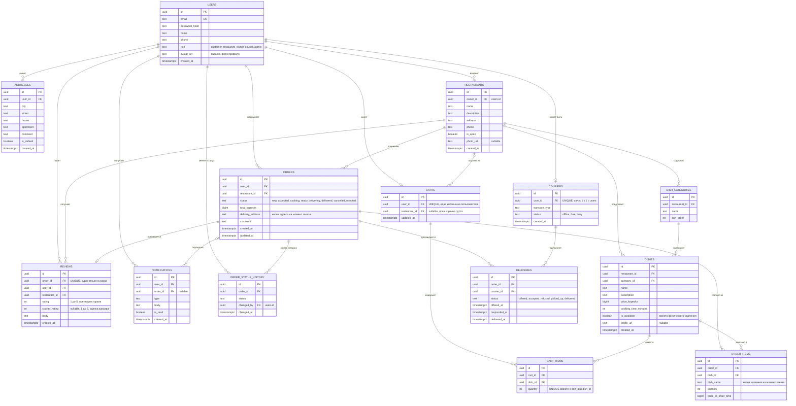

## Миграции

Схема создаётся миграциями из `pass-backend/migrations` (`make migrate-up`):

| Миграция | Что делает |
|---|---|
| `000001_init` | Все 14 таблиц и связи |
| `000002_courier_rating` | `reviews.courier_rating` — оценка курьера в отзыве |
| `000003_photos` | `restaurants.photo_url`, `dishes.photo_url` — фото ресторанов и блюд |
| `000004_avatars` | `users.avatar_url` — фото профиля |

Сами файлы фото хранятся не в базе, а на диске сервера (`out/uploads`), в базе — только путь к файлу.
